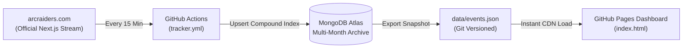

# ARC Raiders · Map Conditions & Event Rotation Tracker

[](https://github.com/goldjunge91/arcraiders-event-tracker/actions/workflows/tracker.yml)
[](https://goldjunge91.github.io/arcraiders-event-tracker/)
[](https://www.mongodb.com/atlas)

A complete, automated system to track, archive, and visualize real-time **Map Conditions** and **Event Rotations** for **ARC Raiders** across all five worldwide server regions.

Live Dashboard: **[https://goldjunge91.github.io/arcraiders-event-tracker/](https://goldjunge91.github.io/arcraiders-event-tracker/)**

---

## Key Features

### 📅 Interactive Timeline Matrix
* **Fixed / Frozen Left Column:** The **Condition & Regions** column remains pinned (`sticky left-0`) with its icons, expand arrows (`▼`), and regional sub-rows while the time axis scrolls horizontally.
* **5 Global Server Regions:** Expand any condition to view individual rows for:
  * 🇪🇺 **Europe (CET / UTC+1)**
  * 🇺🇸 **North America (ET / UTC-5)**
  * 🇧🇷 **South America (BRT / UTC-3)**
  * 🇦🇺 **Oceania (AEDT / UTC+11)**
  * 🇯🇵 **Asia (JST / UTC+9)**
* **Spacious Event Layout:** Generous hourly slots (185px) and readable pills with clear map names, region codes, and status colors:
  * 🟢 **Active Now** (Emerald glow with live remaining countdown)
  * 🔵 **Upcoming** (Sky blue border)
  * ⚫ **Ended** (Faded slate)
* **Time Axis Navigation:** Jump back and forth through history or future schedules with instant 1-click controls:
  * `◀ -6h` · `◀ -1h` · `🔴 Live Now` · `+1h ▶` · `+6h ▶` · `+24h ▶`
  * Drag or horizontal scroll (Shift + MouseWheel / Trackpad).
* **Live Synchronized Needle:** A vertical red indicator with the exact current minute badge moves along the timeline.

---

### 🛡️ Off-Rotation Conditions Included
Even when certain modifiers are rotated out of the active 48-hour schedule, they remain visible in the catalog with official MetaForge icons and an **Off-Rotation** badge:
* 🛡️ **Launch Tower Loot**
* 🗝️ **Locked Gate**
* 📦 **Uncovered Caches**
* ❄️ **Cold Snap**
* 💀 **Husk Graveyard**

When Embark Studios reintroduces them to the schedule, their slots automatically illuminate.

---

### 📊 Multi-Month Persistent Storage & Analytics
* **Permanent Retention:** All events are permanently stored in **MongoDB Atlas** using compound unique indexes `(condition, map, startTime)` to prevent duplicates. Past events are **never deleted**, building a cumulative multi-month historical dataset.
* **Flat Data Export (`data/events.json`):** Every run auto-exports the cumulative database into versioned JSON in the repo, allowing the static frontend on GitHub Pages to load instantly with zero server lag.
* **Analytical Tabs:**
  * **⏰ World Schedule Table:** Chronological table with local times for all 5 regions and live countdowns.
  * **👥 Concurrent Sector Combinations:** Inspect which modifiers run simultaneously across sectors during each 1-hour window.
  * **📊 Frequency & Uptime:** Total occurrences and active hours per condition.
  * **🗺️ Map Matrix:** Cross-matrix showing the frequency of every condition across each map sector.
* **Rich Tooltips:** Integrated with `<script async src="https://static.metaforge.app/arcraiders-tooltips.min.js"></script>` for interactive item and event tooltips.

---

## Architecture & Automation



### Automation Workflow (`.github/workflows/tracker.yml`)
* **Schedule:** Runs every 15 minutes (`cron: '*/15 * * * *'`) and supports manual trigger (`workflow_dispatch`).
* **Process:**
  1. Executes `mongo_tracker.py`.
  2. Extracts official `liveEntries` directly from `https://arcraiders.com/de/map-conditions` with all 5 `regionTimestamps`.
  3. Upserts records to MongoDB Atlas.
  4. Exports cumulative records to `data/events.json`.
  5. Commits and pushes any new snapshot back to `main`.

---

## Setup & Configuration

### 1. MongoDB Atlas Configuration
1. Create a free M0 cluster on [mongodb.com/atlas](https://www.mongodb.com/atlas).
2. Under **Network Access**, allow access from anywhere (`0.0.0.0/0`, required for GitHub Action runners).
3. Under **Database Access**, create a user with read/write privileges.
4. Copy your connection string:
   ```text
   mongodb+srv://<username>:<password>@cluster0.abcde.mongodb.net/?retryWrites=true&w=majority
   ```

### 2. GitHub Secrets
1. Go to your GitHub repository -> **Settings** -> **Secrets and variables** -> **Actions**.
2. Add a new secret:
   * **Name:** `MONGODB_URI`
   * **Value:** Your MongoDB connection string.

### 3. Local Execution
```bash
# Clone repository
git clone https://github.com/goldjunge91/arcraiders-event-tracker.git
cd arcraiders-event-tracker

# Create virtual environment and install dependencies
python3 -m venv .venv
source .venv/bin/activate
pip install -r requirements.txt

# Run tracker locally
export MONGODB_URI="mongodb+srv://..."
python3 mongo_tracker.py
```

---

## Repository Structure

```text
├── .github/workflows/
│   └── tracker.yml         # 15-minute GitHub Action automation
├── data/
│   └── events.json         # Cumulative multi-month historical dataset
├── index.html              # Interactive dashboard for GitHub Pages
├── mongo_tracker.py        # Core scraper & MongoDB Atlas synchronizer
├── requirements.txt        # Python dependencies (pymongo, certifi, dnspython)
└── README.md               # Documentation
```

---

## Attribution & Disclaimer
* **ARC Raiders™** is a registered trademark of Embark Studios AB.
* Rotation schedule and event data extracted from official game announcements and [arcraiders.com](https://arcraiders.com/de/map-conditions).
* Custom event icons and tooltip script provided by [MetaForge.app](https://metaforge.app/arc-raiders).
